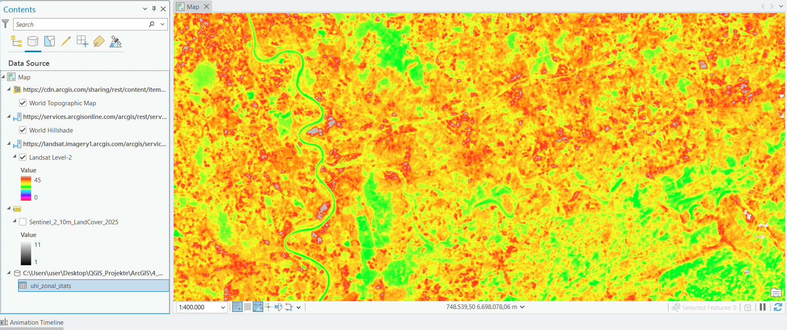
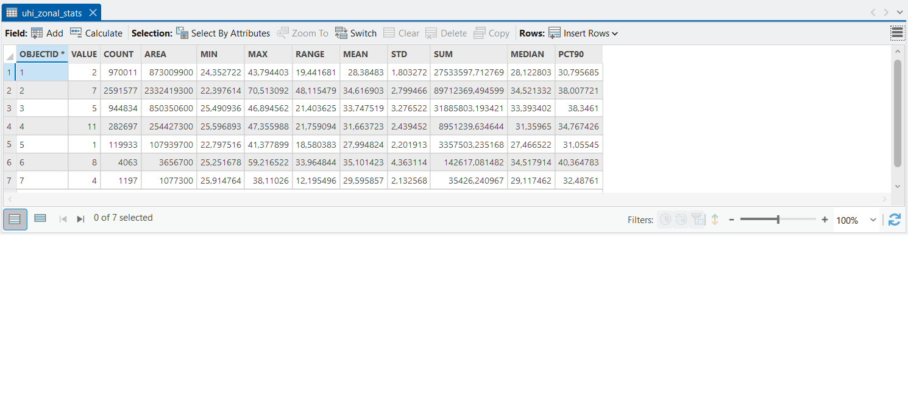

# Urban Heat Island Analysis – Ruhr Area (Essen)

[English](#english) | [Deutsch](#deutsch)

## English

### Overview
Analysis of summer surface temperatures in the Ruhr area around Essen with **Landsat Level-2** imagery and **Sentinel-2 10 m Land Cover** from the Esri **ArcGIS Living Atlas**, done in **ArcGIS Pro**. The question: how much hotter are built-up areas than forests, water and farmland?

Part of my portfolio built on the Esri course *The ArcGIS Imagery MOOC: Foundations and Frontiers*.

### Workflow
1. Added **Landsat Level-2** to a new ArcGIS Pro map and applied the processing template *Surface Temperature (Celsius) for Analysis*.
2. Filtered scenes with a definition query: summer 2025 (June to August) and cloud cover below 10 %.
3. Set a fixed colour scale (0 to 45 °C, red = hot) to visualise the result.
4. Added **Sentinel-2 10 m Land Cover 2025** as the zone layer.
5. Ran *Zonal Statistics as Table* (zones = land cover class, values = surface temperature) with a 30 m cell size, limited to the area around Essen (about 46 x 37 km).
6. Converted the Web Mercator pixel areas to true areas (factor cos² of the latitude, about 0.39).

### Results
| Land cover | Area (km²) | Mean surface temp. (°C) | Median (°C) |
|---|---|---|---|
| Built area | 905.6 | 34.6 | 34.5 |
| Crops | 330.2 | 33.7 | 33.4 |
| Rangeland | 98.8 | 31.7 | 31.4 |
| Trees | 339.0 | 28.4 | 28.1 |
| Water | 41.9 | 28.0 | 27.5 |

Built-up areas are on average **6.2 °C hotter than tree-covered areas** and 6.6 °C hotter than water. Built area makes up about 53 % of the analysed 1,717 km². Full table: [uhi_results.csv](uhi_results.csv). Classes with very few pixels (flooded vegetation, bare ground) are only in the CSV.

### Images

### Limitations
- The map is a mosaic of several clear summer scenes, not a single day.
- Landsat measures **land surface temperature**, not air temperature.
- Landsat thermal data has about 100 m native resolution (resampled to 30 m), land cover has 10 m. Mixed pixels at class borders blur the result.
- Farmland is warm in summer because of dry or harvested fields.
- The ArcGIS statistics were computed in Web Mercator. Means and medians are not affected, areas were corrected with cos² of the latitude.

### Tools
ArcGIS Pro · Landsat Level-2 · Sentinel-2 10 m Land Cover · ArcGIS Living Atlas · Zonal Statistics as Table

---

## Deutsch

[English](#english) | [Deutsch](#deutsch)

### Überblick
Analyse der sommerlichen Oberflächentemperaturen im Ruhrgebiet rund um Essen mit **Landsat Level-2** und **Sentinel-2 10 m Landbedeckung** aus dem Esri **ArcGIS Living Atlas**, umgesetzt in **ArcGIS Pro**. Die Frage: Wie viel heißer sind bebaute Flächen als Wald, Wasser und Ackerland?

Teil meines Portfolios zum Esri-Kurs *The ArcGIS Imagery MOOC: Foundations and Frontiers*.

### Vorgehen
1. **Landsat Level-2** in eine neue ArcGIS-Pro-Karte geladen und die Verarbeitungsvorlage *Surface Temperature (Celsius) for Analysis* angewendet.
2. Szenen per Definitionsabfrage gefiltert: Sommer 2025 (Juni bis August) und Wolkenbedeckung unter 10 %.
3. Feste Farbskala (0 bis 45 °C, rot = heiß) zur Darstellung gesetzt.
4. **Sentinel-2 10 m Landbedeckung 2025** als Zonen-Layer hinzugefügt.
5. *Zonal Statistics as Table* ausgeführt (Zonen = Landbedeckungsklasse, Werte = Oberflächentemperatur) mit 30 m Zellgröße, begrenzt auf den Raum Essen (ca. 46 x 37 km).
6. Pixelflächen aus Web Mercator in echte Flächen umgerechnet (Faktor cos² der Breite, ca. 0,39).

### Ergebnisse
| Landbedeckung | Fläche (km²) | Mittlere Oberflächentemp. (°C) | Median (°C) |
|---|---|---|---|
| Bebaut | 905,6 | 34,6 | 34,5 |
| Ackerland | 330,2 | 33,7 | 33,4 |
| Grünland | 98,8 | 31,7 | 31,4 |
| Bäume | 339,0 | 28,4 | 28,1 |
| Wasser | 41,9 | 28,0 | 27,5 |

Bebaute Flächen sind im Mittel **6,2 °C heißer als baumbestandene Flächen** und 6,6 °C heißer als Wasser. Bebaute Fläche macht etwa 53 % der untersuchten 1.717 km² aus. Vollständige Tabelle: [uhi_results.csv](uhi_results.csv).

### Bilder
Die Bilder (Temperaturkarte, Attributtabelle) befinden sich im englischen Abschnitt oben.

### Einschränkungen
- Die Karte ist ein Mosaik mehrerer klarer Sommerszenen, kein einzelner Tag.
- Landsat misst die **Landoberflächentemperatur**, nicht die Lufttemperatur.
- Die thermischen Landsat-Daten haben ca. 100 m native Auflösung (auf 30 m resampled), die Landbedeckung 10 m. Mischpixel an Klassengrenzen verwischen das Ergebnis.
- Ackerland ist im Sommer warm wegen trockener oder abgeernteter Felder.
- Die ArcGIS-Statistiken wurden in Web Mercator berechnet. Mittelwerte und Mediane sind davon nicht betroffen, die Flächen wurden mit cos² der Breite korrigiert.

### Werkzeuge
ArcGIS Pro · Landsat Level-2 · Sentinel-2 10 m Landbedeckung · ArcGIS Living Atlas · Zonal Statistics as Table
